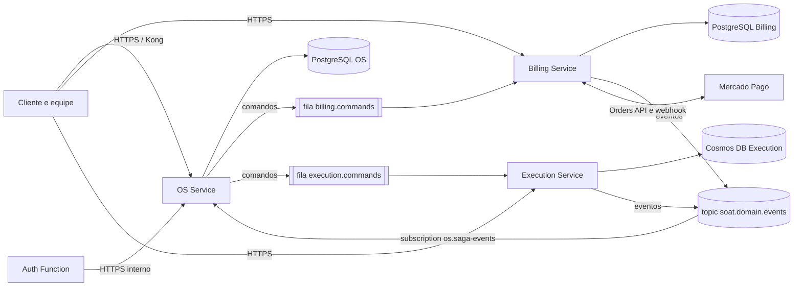

# soat-api

API NestJS do Sistema Integrado de Oficina e **OS Service** da Fase 4. Este
repositório concentra a aplicação, o orquestrador da Saga, migrations Prisma,
testes automatizados, Dockerfile, manifests de deploy e a documentação
arquitetural central.

## Stack

- Node.js 24 nos containers e no CI, TypeScript e NestJS;
- PostgreSQL e Prisma;
- JWT administrativo e JWT de cliente, Swagger, Jest e Docker;
- Kustomize, AKS, Kong, Key Vault e Workload Identity para o deploy Azure.

## Execução e validação local

```bash
npm ci
npx prisma generate
npm run build
npm run lint
npm run test:cov
docker compose -f docker-compose.test.yml up -d
npm run test:e2e
docker compose -f docker-compose.test.yml down
```

## Variáveis

Configure as variáveis descritas em `.env.example`. Para testes locais, copie
`.env.test.example` para `.env.test`; esse arquivo local é ignorado pelo Git e
nunca deve conter uma URL ou segredo de produção.

`JWT_SECRET` é exclusivo do login administrativo. `JWT_CLIENT_SECRET`,
`JWT_CLIENT_ISSUER=soat-auth-function` e `JWT_CLIENT_AUDIENCE=soat-api` são
exclusivos dos tokens emitidos pela Function de autenticação CPF. Os dois
fluxos não compartilham segredo nem guard.

## Entrega e arquitetura

- Swagger: `http://localhost:3000/docs` local e
  `http://20.226.244.207/docs` em HML;
- Collection: `docs/postman/oficina-api.postman_collection.json`;
- Testes: `docs/testes.md`;
- RFCs e ADRs: `docs/architecture/README.md`.
- Modelo ER e decisão de banco:
  `docs/architecture/modelo-er-postgresql.md`;
- Diagrama central dos quatro repositórios e deploy:
  `docs/architecture/README.md#mapa-de-responsabilidades-dos-repositórios`.
- Deploy imutável: `docs/deploy-api.md`.
- Fase 4: [ADR de fronteiras e Saga](docs/adr/0001-fronteiras-e-saga.md),
  [estado da Saga](docs/fase4-saga.md),
  [operação e recuperação](docs/operacao-fase4.md) e
  [contratos de mensagens](docs/contracts/messages/README.md).

Em HML, a API está implantada no AKS e somente o proxy Kong a expõe; a
Function de CPF atende `POST /auth/cpf`. A consulta pública por código de
acompanhamento foi substituída por `GET /cliente/ordens-servico/:id` e pelas
ações autenticadas de aprovar/recusar orçamento. Em produção, o Service
permanece interno, sem URL pública, até decisão posterior de domínio e gateway.
O CI também implanta cada SHA em um cluster Kubernetes efêmero (kind), descrito
em [CI/CD e deploy](#cicd-e-deploy).

Use `JWT_ADMIN` nas rotas administrativas e `JWT_CLIENTE` apenas nas rotas de
cliente. A coleção mantém esses tokens separados nas variáveis `token` e
`clienteToken`; não inclua valores reais no arquivo.

## Fase 4 — OS Service

### Microsserviços e propriedade dos dados

| Serviço | Repositório | Responsabilidade | Banco próprio |
| --- | --- | --- | --- |
| OS Service | [soat-api](https://github.com/JoaoGW/soat-api) | Clientes, veículos, abertura e acompanhamento da OS, histórico, relatórios, autorização e orquestração da Saga | PostgreSQL (SQL) |
| Billing Service | [soat-billing-service](https://github.com/JoaoGW/soat-billing-service) | Orçamento versionado, aprovação, cobrança Mercado Pago, pagamento, reembolso e notificações | PostgreSQL (SQL) |
| Execution Service | [soat-execution-service](https://github.com/JoaoGW/soat-execution-service) | Catálogo, estoque por filial, diagnóstico, reserva de peças, fila e reparo | Cosmos DB for NoSQL |

Nenhum serviço lê o banco de outro: as integrações usam REST quando o cliente
precisa de resposta imediata e Service Bus (duas filas de comandos e um topic de
eventos) para o fluxo da OS. A Auth Function consulta o OS por HTTPS com
credencial exclusiva, sem acesso ao PostgreSQL.



### Saga orquestrada

A Saga é **orquestrada pelo OS**. O OS é o dono do ciclo de vida da ordem e
precisa expor ao cliente o andamento, os prazos e as pendências; concentrar as
decisões nele deixa a ordem das compensações explícita, auditável e retomável
sem que os participantes conheçam uns aos outros. Na coreografia cada serviço
reagiria aos eventos dos demais, espalhando a regra "pagamento antes do reparo"
e a ordem do rollback por três bases de código. A decisão está registrada no
[ADR 0001](docs/adr/0001-fronteiras-e-saga.md).

```mermaid
sequenceDiagram
  participant OS as OS (orquestrador)
  participant EX as Execution
  participant BI as Billing
  participant MP as Mercado Pago
  OS->>EX: execution.request-diagnosis.v1
  EX-->>OS: execution.diagnosis-completed.v1 (itens e preços fixados)
  OS->>BI: billing.generate-quote.v1
  BI-->>OS: billing.quote-issued.v1
  Note over OS,BI: cliente aprova a versão do orçamento
  BI-->>OS: billing.quote-approved.v1
  OS->>EX: execution.reserve-parts.v1
  EX-->>OS: execution.parts-reserved.v1
  OS->>BI: billing.create-charge.v1
  BI->>MP: cria order QR (idempotente)
  BI-->>OS: billing.charge-created.v1
  MP-->>BI: webhook HMAC + consulta canônica
  BI-->>OS: billing.payment-confirmed.v1
  OS->>EX: execution.enqueue-work.v1
  EX-->>OS: work-enqueued / work-started / work-completed
  Note over OS: Saga FINALIZADA; entrega posterior no OS
```

| Falha | Compensação conduzida pelo OS |
| --- | --- |
| Orçamento recusado ou expirado | `execution.cancel-work.v1` e, confirmado que o trabalho não começou, `execution.release-parts.v1` |
| Estoque insuficiente | Saga cancelada sem criar cobrança |
| Cobrança expirada ou cancelada antes do pagamento | `billing.cancel-charge.v1` (uma tentativa e consulta canônica), depois liberação das peças |
| Falha após pagamento confirmado | Cancelamento do trabalho, `billing.refund-payment.v1` com evidência de não início e liberação após o reembolso |
| Pagamento tardio | Execução cercada e reconciliação, sem liberar o reparo |
| Reparo físico já iniciado | Sem rollback fictício: a Saga vai para reconciliação operacional |

Cada etapa grava estado, operação, inbox e outbox na mesma transação local. A
entrega é pelo menos uma vez, com `messageId` e `operationId` estáveis,
deduplicação, correlação/causalidade e assinatura Ed25519 por produtor.
Timeout, falha de rede ou ausência de evento nunca são tratados como prova de
cancelamento, reembolso ou liberação: a Saga fica em `RECONCILIACAO_NECESSARIA`
e o [procedimento operacional](docs/operacao-fase4.md) descreve a retomada.
Prazos padrão: aprovação em 24 horas, cobrança em 15 minutos, revisão da reserva
em 20 minutos, verificação a cada 60 segundos e até cinco tentativas transitórias.

### Mensageria e assinatura

A mensageria usa assinatura Ed25519 do JSON canônico (chaves de objetos
ordenadas, UTF-8, prefixo `soat-message-v1` e assinatura em base64 na
propriedade AMQP `signature`). Cada serviço possui uma chave privada própria e
os consumidores recebem somente as chaves públicas dos produtores. O OS usa
`OS_MESSAGE_PRIVATE_KEY`, `BILLING_MESSAGE_PUBLIC_KEY` e
`EXECUTION_MESSAGE_PUBLIC_KEY`; os workers falham ao iniciar sem as chaves.
Os schemas versionados dos comandos e eventos estão em
[`docs/contracts/messages`](docs/contracts/messages/README.md) e são validados
por `npm run test:contracts`.

### Configuração da Fase 4

As capacidades da Fase 4 usam o banco dedicado `SAGA_DATABASE_URL` (migrations
em `prisma/os`, aplicadas por `npm run db:migrate:deploy`) e ficam desativadas
por padrão. Nunca aplicar a migration da Fase 4 sobre o banco legado.

| Variável | Habilita |
| --- | --- |
| `ENABLE_FASE4_REGISTRY` | `/fase4/clientes`, `/fase4/veiculos`, consultas de OS, histórico, fila operacional e relatório de tempo médio |
| `ENABLE_FASE4_OPEN` | `POST /fase4/ordens-servico` (JWT administrativo e `Idempotency-Key`) |
| `ENABLE_FASE4_COMPENSATION` | `POST /fase4/ordens-servico/:sagaId/compensar` |
| `ENABLE_FASE4_DELIVERY` | `POST /fase4/ordens-servico/:osId/entregar` |
| `ENABLE_FASE4_RECOVERY` | Reprocessamento auditado de comando e reconciliação de pagamento ou reparo |
| `ENABLE_SAGA_COMMAND_PUBLISHER` | Outbox para `SERVICE_BUS_BILLING_QUEUE` e `SERVICE_BUS_EXECUTION_QUEUE` |
| `ENABLE_SAGA_EVENT_CONSUMER` | Consumo do topic `SERVICE_BUS_EVENT_TOPIC` pela `SERVICE_BUS_SAGA_SUBSCRIPTION` |
| `ENABLE_SAGA_REPLAY` | Reaplicação periódica de eventos fora de ordem |
| `ENABLE_SAGA_DEADLINE_REVIEW` | Revisão de prazos a cada 60 segundos |
| `ENABLE_SAGA_CHARGE_CANCELLATION` | Comando de cancelamento de cobrança sem pagamento |

A cobrança exige `MERCADO_PAGO_EXTERNAL_POS_ID`. A integração de CPF fica em
`/fase4/internal/clientes/validar-cpf`, com bearer exclusivo
(`INTERNAL_CLIENT_LOOKUP_TOKEN`); `/fase4/cliente/ordens-servico` oferece
listagem, detalhe e histórico restritos ao cliente autenticado. As rotas da
Fase 4 coexistem com as legadas até o cutover do ambiente.

### Operação e recuperação

O [procedimento operacional](docs/operacao-fase4.md) cobre publicação esgotada,
prazos, resultados incertos e a recuperação auditada da DLQ
(`npm run ops:recover-saga-dlq`, incluído na imagem e travado sem habilitação).
Pagamento tardio é tratado por
`POST /fase4/ordens-servico/:sagaId/reconciliar-pagamento`, que cerca a
execução; reparo concluído durante reconciliação usa
`POST /fase4/ordens-servico/:sagaId/reconciliar-reparo`, que exige evidências
de pagamento, fila, início e conclusão. Não altere status diretamente para
contornar essas verificações.

## Testes, cobertura e qualidade

| Suíte | Comando | Escopo |
| --- | --- | --- |
| Unitários com cobertura | `npm run test:cov` | Domínio, casos de uso, controllers e adapters |
| Mensageria | `npm run test:coverage-messaging` | Publicadores, consumidores e assinatura (gate de 80%) |
| Saga com PostgreSQL | `npm run test:coverage-saga` | Infraestrutura da Saga (gate de 80%) |
| Cobertura total | `npm run test:coverage-full` | Unitários, integração da Saga e HTTP, inclusive o legado (gate de 80%) |
| e2e | `npm run test:e2e` | API HTTP contra PostgreSQL |
| BDD distribuído | `npm run test:bdd-distributed` | `test/broker/aceite.feature` com OS, Billing e Execution |

### Evidência de cobertura

Medição do [CI](https://github.com/JoaoGW/soat-api/actions/workflows/ci.yml) no commit `d1762d8`, com gate mínimo de 80% em cada métrica (`npm run test:coverage-full`):

| Escopo | Statements | Branches | Functions | Lines |
| --- | --- | --- | --- | --- |
| OS completo (unitários, Saga e HTTP) | 90.98% | 81.60% | 93.40% | 91.98% |

Cada execução publica os totais do próprio SHA no resumo do job e como anotação (`scripts/quality/coverage-summary.cjs`) e anexa o relatório completo como artefato.

O BDD distribuído (Cucumber) executa a jornada completa e as compensações com
os três serviços, PostgreSQL, emuladores Service Bus e Cosmos e provedor de
pagamento simulado: jornada feliz, timeouts de cobrança e reembolso, pagamento
tardio, estoque insuficiente, reparo iniciado, cancelamento sem pagamento,
resposta perdida, evidência divergente, retomada após queda de processos,
jornada pelas APIs HTTP e propagação de trace. A preparação está em
[`test/broker/README.md`](test/broker/README.md) e o workflow manual
[`bdd-distribuido.yml`](.github/workflows/bdd-distribuido.yml) fixa os SHAs de
Billing, Execution e Auth; ele exige o secret `CROSS_REPO_READ_TOKEN` com
leitura dos repositórios privados e o aceite dos termos dos emuladores.

`npm run quality:sonarjs` aplica regras selecionadas do analisador SonarJS
(SonarSource) para erros lógicos e segurança com `--max-warnings=0`. É o gate
de qualidade similar ao SonarQube adotado no CI; não inclui o painel do
SonarQube.

## CI/CD e deploy

O [workflow CI](https://github.com/JoaoGW/soat-api/actions/workflows/ci.yml)
roda em todo pull request e em push para `main` e `development`:

1. **API quality and tests**: Prisma, lint, SonarJS, contratos, build, imagem
   Docker, cobertura unitária e de mensageria e e2e;
2. **Saga OS PostgreSQL** e **Cobertura combinada de todo o OS**: gates de 80%;
3. **Validar manifests Kustomize**: HML, PROD e job de migration, sem `latest`;
4. **Deploy Kubernetes (kind)**: cria um cluster kind efêmero, carrega a imagem
   do SHA, sobe o PostgreSQL do serviço, executa as migrations do banco legado
   e do banco da Saga, aplica o overlay
   [`deploy/kustomize/overlays/kind`](deploy/kustomize/overlays/kind) e valida o
   rollout: `/health` com o SHA implantado, Swagger, rota protegida sem token e
   login administrativo com consulta da fila operacional no banco da Fase 4.

A `main` exige pull request e os checks acima. O workflow
[`deploy.yml`](.github/workflows/deploy.yml) publica somente
`ghcr.io/joaogw/soat-api:<SHA_DO_COMMIT>` após o CI de um push aprovado ou por
execução manual com o SHA completo, verificando o CI e a ponta da branch antes
de publicar e de aplicar no AKS. Os jobs de HML e produção só executam com a
variável protegida `TF_APPLY_ENABLED=true`; ela permanece `false` enquanto a
assinatura Azure estiver desativada, por isso o ambiente kind é o deploy
automatizado verificável de cada revisão.

O workflow [**Fluxo completo em Kubernetes**](.github/workflows/fluxo-completo-kind.yml)
sobe OS, Billing e Execution juntos em um cluster kind, cada um com o próprio
banco, com os emuladores de Service Bus e Cosmos DB e o Mercado Pago simulado, e
executa pelas APIs HTTP a jornada completa da OS e a compensação após pagamento.
O mesmo ambiente roda no Mac com `scripts/kind/ambiente.sh` e aceita credenciais
de teste do Mercado Pago e a chave do New Relic; o passo a passo está em
[`docs/ambiente-kind.md`](docs/ambiente-kind.md). Os serviços só aceitam
emuladores com `ALLOW_LOCAL_EMULATORS=true`.

Para reproduzir o deploy localmente com Docker, kind e kubectl, siga os passos
do job `deploy_kind`: `docker build -t ghcr.io/joaogw/soat-api:<sha> .`,
`kind create cluster`, `kind load docker-image`, crie os secrets `os-postgres`
e `soat-api-runtime` e aplique `kubectl kustomize deploy/kustomize/overlays/kind`
substituindo `sha-not-set`, `__ENVIRONMENT__` e `__APP_VERSION__`.

## Observabilidade

Traces, métricas e logs OpenTelemetry são exportados ao New Relic, reutilizando
a stack da Fase 3 (`OBSERVABILITY_ENABLED=true` e `NEW_RELIC_LICENSE_KEY`). O
contexto W3C é propagado pelas mensagens do Service Bus, de modo que a mesma OS
pode ser rastreada entre OS, Billing e Execution. Detalhes em
[`docs/observabilidade.md`](docs/observabilidade.md).

## Dependências sobrescritas

O Multer é fixado em 2.5.0 por override, pois a versão do Nest fixa uma versão
anterior; um teste HTTP cobre a compatibilidade básica do interceptor com
filtro assíncrono. Retire o override quando o Nest incorporar uma versão
corrigida e repita os testes. O CLI Prisma 6, usado nas migrations, ainda possui
alertas transitivos e requer atualização compatível.
