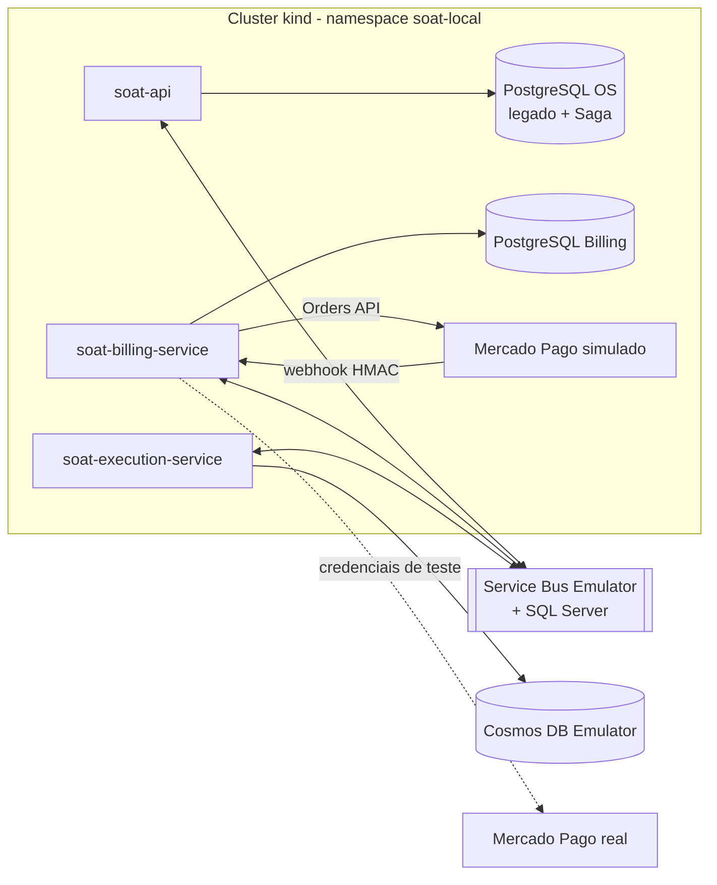

# Ambiente completo em Kubernetes (kind)

Sobe os três microsserviços da Fase 4 em um cluster kind local, cada um com o
próprio banco, e executa a jornada completa da OS pela Saga. É o ambiente usado
na demonstração e no workflow [Fluxo completo em Kubernetes](../.github/workflows/fluxo-completo-kind.yml).



Os emuladores rodam como containers na rede Docker do kind, no papel dos serviços
gerenciados do Azure; os serviços os acessam por `Service` + `EndpointSlice`.
Os workloads aceitam connection string do emulador e chave do Cosmos somente com
`ALLOW_LOCAL_EMULATORS=true`; no AKS continuam exclusivos de identidade de workload.

## Pré-requisitos

- Docker Desktop com 8 GB de memória, `kind`, `kubectl`, `openssl` e `git`;
- no Apple Silicon, ative *Use Rosetta for x86_64/amd64 emulation* no Docker
  Desktop: SQL Server e Service Bus Emulator são publicados somente para amd64;
- leitura e aceite dos termos do [SQL Server](https://go.microsoft.com/fwlink/?linkid=857698)
  e do [Service Bus Emulator](https://github.com/Azure/azure-service-bus-emulator-installer/blob/main/EMULATOR_EULA.txt),
  informado com `SOAT_ACCEPT_EULA=Y`.

Os repositórios de Billing e Execution são usados de `../soat-billing-service` e
`../soat-execution-service`; se não existirem, o script os clona na branch
`development` (ou em `SOAT_SERVICES_BRANCH`).

## Uso

```bash
SOAT_ACCEPT_EULA=Y scripts/kind/ambiente.sh subir   # imagens, cluster, emuladores, bancos e serviços
scripts/kind/ambiente.sh jornada                     # jornada completa até a entrega
CENARIO=compensacao scripts/kind/ambiente.sh jornada # falha após pagamento e compensação
scripts/kind/ambiente.sh portas                      # OS :3001, Billing :3002, Execution :3003 (até Ctrl+C)
scripts/kind/ambiente.sh destruir
```

Os encaminhamentos de porta são refeitos se o pod reiniciar e encerrados junto
com o comando. Com as portas abertas, o Swagger do OS fica em `http://localhost:3001/docs`. Os
segredos (chaves Ed25519 por serviço, JWT, senhas dos bancos e do administrador)
são gerados em `.kind-local/`, ignorado pelo Git. A senha do usuário `admin` fica
em `.kind-local/admin-password`.

O `subir` também aponta o CoreDNS do cluster para `1.1.1.1` e `8.8.8.8`: o DNS
repassado pelo Docker Desktop perde consultas em algumas redes, e a chamada ao
Mercado Pago sem resposta deixaria a cobrança em reconciliação.

## Mercado Pago de teste e New Relic

Sem credenciais, o Billing usa o simulador da Orders API, que envia o webhook
assinado como o provedor real. Para usar o Mercado Pago de teste e o New Relic,
crie `.env.kind.local` (ignorado pelo Git) antes de `subir`:

```bash
MERCADO_PAGO_ACCESS_TOKEN=...      # access token do vendedor de teste
MERCADO_PAGO_WEBHOOK_SECRET=...    # assinatura secreta do webhook
MERCADO_PAGO_EXTERNAL_POS_ID=...   # external_pos_id do caixa de teste
NEW_RELIC_LICENSE_KEY=...          # ingest license key
```

O `external_pos_id` vem do caixa do vendedor de teste. Com o token já no
arquivo, `scripts/kind/mercado-pago-caixa.sh` cria a loja e o caixa pela API e
grava o identificador em `.env.kind.local`, sem exibir o token.

Depois de `subir`, execute `scripts/kind/ambiente.sh tunel` e cadastre no painel
do Mercado Pago a URL HTTPS exibida seguida de `/webhooks/mercado-pago`, para o
evento de orders. Em seguida rode `jornada`: o script mostra o QR e aguarda o
pagamento feito com o comprador de teste. Com a chave do New Relic, o
OpenTelemetry Collector do cluster também encaminha ao New Relic os traces,
métricas e logs dos três serviços, com o mesmo contexto W3C da OS.

## E-mail do orçamento (Mailpit)

O Billing envia o orçamento para aprovação por e-mail (itens, total, validade e
como aprovar). No kind o envio vai a um Mailpit dentro do cluster: com
`scripts/kind/ambiente.sh portas` em execução, os e-mails aparecem em
http://localhost:8025. A `jornada` confere que o e-mail da OS chegou e o exibe.

## Observabilidade no cluster (sem custo)

O `subir` implanta no namespace `soat-local` um OpenTelemetry Collector, o
Jaeger (traces), o Prometheus (métricas) e o Grafana (painel **SOAT Fase 4 —
Microsserviços**, com requisições, latência p95, erros 5xx e traces recentes
por serviço). Os três serviços sempre enviam OTLP ao Collector
(`http://otel-collector:4318`), sem chave; a chave do New Relic, se existir,
fica apenas no Collector.

```bash
scripts/kind/ambiente.sh observabilidade   # Jaeger :16686, Grafana :3005, Prometheus :9090
scripts/kind/ambiente.sh traces            # confere um único trace atravessando OS, Billing e Execution
```

No Jaeger, busque o serviço `soat-execution-service` ou `soat-api` e abra o
trace indicado pelo comando `traces`: ele mostra a requisição HTTP, a mensagem
no Service Bus e o processamento nos outros serviços com o mesmo trace ID. O
workflow "Fluxo completo em Kubernetes" executa a mesma verificação após a
jornada e publica o resultado no resumo do job.

## Solução de problemas

- **Pagamento aprovado e a Saga parada em `AGUARDANDO_PAGAMENTO`:** o webhook
  não chegou ao Billing (o Terminal do túnel mostra `Unable to reach the origin
  service`). Isso acontece quando os pods reiniciam durante o pagamento; rode a
  `jornada` só depois que o `subir` terminar. O Mercado Pago tenta reenviar a
  notificação, e o Billing confirma o pagamento consultando a order.
- **Pagamento confirmado depois do prazo da cobrança (15 minutos):** a Saga vai
  para `RECONCILIACAO_NECESSARIA` com `DEADLINE_EXPIRED`, de propósito: o OS não
  enfileira trabalho de cobrança vencida e deixa a decisão para a operação.
- **Mensagens paradas e `soat-mssql` encerrado com código 139:** sob emulação
  amd64 o SQL Server pode falhar e o Service Bus Emulator deixa de entregar
  mensagens. O contêiner é religado pelo Docker; confira com
  `docker ps -a --filter name=soat-mssql`.
- **New Relic sem dados (HTTP 403 na exportação OTLP):** `NEW_RELIC_LICENSE_KEY`
  precisa ser a chave do tipo *Ingest - License* (40 caracteres terminados em
  `NRAL`), não o ID da chave exibido na lista de API keys.
