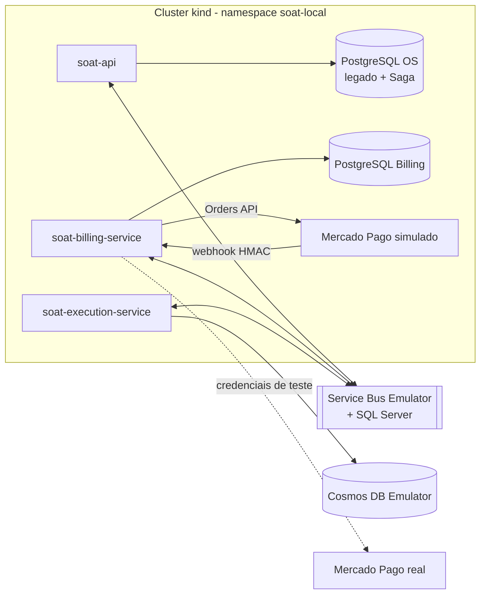

# Ambiente completo em Kubernetes (kind)

Sobe os três microsserviços da Fase 4 em um cluster kind local, cada um com o
próprio banco, e executa a jornada completa da OS pela Saga. É o ambiente usado
na demonstração e no workflow [Fluxo completo em Kubernetes](../.github/workflows/fluxo-completo-kind.yml).



Os emuladores rodam como containers na rede Docker do kind, no papel dos serviços
gerenciados do Azure; os serviços os acessam por `Service` + `EndpointSlice`.
Os workloads aceitam connection string do emulador e chave do Cosmos somente com
`ALLOW_LOCAL_EMULATORS=true`; no AKS continuam exclusivos de identidade de workload.

## Pré-requisitos

- Docker Desktop com 8 GB de memória, `kind`, `kubectl`, `openssl` e `git`;
- no Apple Silicon, ative *Use Rosetta for x86_64/amd64 emulation* no Docker
  Desktop: SQL Server e Service Bus Emulator são publicados somente para amd64;
- leitura e aceite dos termos do [SQL Server](https://go.microsoft.com/fwlink/?linkid=857698)
  e do [Service Bus Emulator](https://github.com/Azure/azure-service-bus-emulator-installer/blob/main/EMULATOR_EULA.txt),
  informado com `SOAT_ACCEPT_EULA=Y`.

Os repositórios de Billing e Execution são usados de `../soat-billing-service` e
`../soat-execution-service`; se não existirem, o script os clona na branch
`development` (ou em `SOAT_SERVICES_BRANCH`).

## Uso

```bash
SOAT_ACCEPT_EULA=Y scripts/kind/ambiente.sh subir   # imagens, cluster, emuladores, bancos e serviços
scripts/kind/ambiente.sh jornada                     # jornada completa até a entrega
CENARIO=compensacao scripts/kind/ambiente.sh jornada # falha após pagamento e compensação
scripts/kind/ambiente.sh portas                      # OS :3001, Billing :3002, Execution :3003
scripts/kind/ambiente.sh destruir
```

Com as portas abertas, o Swagger do OS fica em `http://localhost:3001/docs`. Os
segredos (chaves Ed25519 por serviço, JWT, senhas dos bancos e do administrador)
são gerados em `.kind-local/`, ignorado pelo Git. A senha do usuário `admin` fica
em `.kind-local/admin-password`.

## Mercado Pago de teste e New Relic

Sem credenciais, o Billing usa o simulador da Orders API, que envia o webhook
assinado como o provedor real. Para usar o Mercado Pago de teste e o New Relic,
crie `.env.kind.local` (ignorado pelo Git) antes de `subir`:

```bash
MERCADO_PAGO_ACCESS_TOKEN=...      # access token do vendedor de teste
MERCADO_PAGO_WEBHOOK_SECRET=...    # assinatura secreta do webhook
MERCADO_PAGO_EXTERNAL_POS_ID=...   # external_pos_id do caixa de teste
NEW_RELIC_LICENSE_KEY=...          # ingest license key
```

Depois de `subir`, execute `scripts/kind/ambiente.sh tunel` e cadastre no painel
do Mercado Pago a URL HTTPS exibida seguida de `/webhooks/mercado-pago`, para o
evento de orders. Em seguida rode `jornada`: o script mostra o QR e aguarda o
pagamento feito com o comprador de teste. Com a chave do New Relic, os três
serviços exportam traces e métricas com o mesmo contexto W3C da OS.
