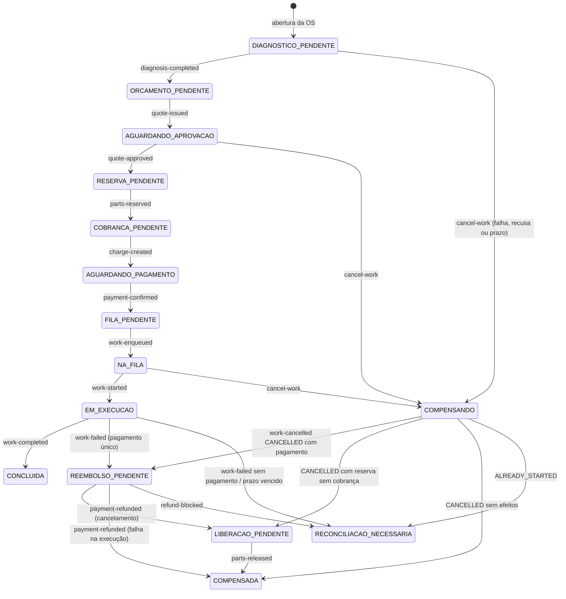

# Saga OS — estado e validações

`ReceiveChargeEvent` registra eventos de cobrança na inbox e verifica se o
identificador, filial, OS e dados correspondem à operação e ao comando já
persistidos. Para cobrança criada, com a Saga na etapa esperada e orçamento
correspondente, a atualização da Saga, o resultado da operação e a inbox são
confirmados na mesma transação. Eventos fora de ordem e eventos de falha ficam
pendentes. A reaplicação paginada de cobranças, pagamentos e confirmações de fila é executada por um agendador
opcional, desativado por padrão.

Os consumidores de eventos de cobrança e pagamento validam JSON Schema e confirmam mensagens
somente após a gravação da inbox. O consumidor do broker está ligado ao processo, mas é desativado por padrão.
Ele roteia orçamento, diagnóstico, reserva, cobrança, pagamento, fila, reparo
e eventos de compensação; eventos desconhecidos são devolvidos e podem chegar à
DLQ após as tentativas. Assinaturas Ed25519 são verificadas por produtor. O
fluxo e compensações foram exercitados com emuladores locais; antes de tráfego,
é necessário validar identidade e transporte no ambiente real e concluir as
verificações de operação descritas em `operacao-fase4.md`.

`npm run test:os-integration` exige `DATABASE_URL` apontando para PostgreSQL
local com nome terminado em `_test`, após `npm run db:migrate:deploy` no banco
OS dedicado. Nunca executar a migration da Fase 4 sobre o banco legado.

O recebimento de `execution.work-enqueued.v1` valida o comando e avança
`FILA_PENDENTE` para `NA_FILA` com inbox e operação na mesma transação.
Eventos recebidos fora de ordem também podem ser reaplicados; não são aplicados
enquanto a Saga está compensando.

O agendador exige `ENABLE_SAGA_REPLAY=true` e `SAGA_DATABASE_URL` para o
banco dedicado da Fase 4. Ele percorre as páginas pendentes e reinicia a
varredura a cada 60 segundos. Não habilitar antes de configurar e validar os
fluxos no ambiente isolado.

Pagamento confirmado fica pendente até associar cobrança, orçamento e reserva
confirmada à mesma Saga. Quando os pré-requisitos existem, a Saga, operação e
comando `execution.enqueue-work.v1` são gravados atomicamente. Pagamento
tardio ou order divergente exige reconciliação. Execution possui consumidor
para o comando de fila, desativado por padrão e sujeito à configuração e
validação do broker e Cosmos no ambiente real.

O recebimento exige `ENABLE_SAGA_EVENT_CONSUMER=true`, `SAGA_DATABASE_URL`,
namespace, topic, subscription e identidade de workload. Sua ativação exige
também a validação do isolamento entre produtores no broker.

## Estados da Saga

Status da OS ao longo da jornada feliz (tabela `HistoricoStatusOS`, consultado em
`GET /fase4/ordens-servico/:id/historico`): `RECEBIDA → EM_DIAGNOSTICO →
AGUARDANDO_APROVACAO → APROVADA → PAGAMENTO_CONFIRMADO → EM_EXECUCAO →
FINALIZADA → ENTREGUE`. A confirmação do pagamento pelo Billing
(`billing.payment-confirmed.v1`) atualiza a OS para `PAGAMENTO_CONFIRMADO`.

| Estado | OS | Próximo fato esperado | Compensação |
|---|---|---|---|
| DIAGNOSTICO_PENDENTE | RECEBIDA / EM_DIAGNOSTICO | diagnóstico de Execution | cancel-work |
| ORCAMENTO_PENDENTE | EM_DIAGNOSTICO | orçamento do Billing | cancel-work |
| AGUARDANDO_APROVACAO | AGUARDANDO_APROVACAO (recusa → ORCAMENTO_RECUSADO) | decisão do cliente | cancel-work |
| RESERVA_PENDENTE / COBRANCA_PENDENTE / AGUARDANDO_PAGAMENTO | APROVADA | reserva, cobrança, pagamento | cancel-work, depois cancelamento de cobrança e liberação |
| FILA_PENDENTE | PAGAMENTO_CONFIRMADO | confirmação da fila | cancel-work, estorno e liberação |
| NA_FILA | PAGAMENTO_CONFIRMADO | início do reparo | cancel-work, estorno e liberação de peças |
| EM_EXECUCAO | EM_EXECUCAO | conclusão ou falha | sem rollback automático; falha declarada → estorno |
| REEMBOLSO_PENDENTE | — / FALHA_EXECUCAO | payment-refunded | — |
| COMPENSADA | CANCELADA | — | concluída |
| RECONCILIACAO_NECESSARIA | inalterada | ação do operador ou fato autenticado | — |

## Falha na execução após o pagamento

`execution.work-failed.v1` (subscription `os.saga-events`, consumidor
`ReceiveWorkFailedEvent`) é aceito quando OS, Saga, filial, `executionId` e
`reservationId` batem com a Saga e `startedAt` é igual ao do
`work-started` aplicado. A inbox garante idempotência: reentrega da mesma
mensagem ou do mesmo fato com outro `messageId` não gera novo estorno, e um
fato divergente é recusado. Falha recebida antes do início fica `PENDING` e é
reaplicada pelo agendador.

- Com exatamente um `billing.payment-confirmed.v1` aplicado para o `chargeId`
  da Saga, grava `billing.refund-payment.v1` com motivo `EXECUTION_FAILED`,
  `cancelOperationId`/`cancelEventId` iguais ao `operationId`/`messageId` do
  `work-failed` (evidência verificada pelo Billing), Saga em
  `REEMBOLSO_PENDENTE` com `lastError=EXECUTION_FAILED` e OS em
  `FALHA_EXECUCAO` com histórico.
- Sem pagamento único comprovado: `RECONCILIACAO_NECESSARIA`,
  `requiresAttention=true`, `lastError=EXECUTION_FAILED`.
- `billing.payment-refunded.v1` desse estorno conclui a Saga em `COMPENSADA` e
  a OS em `CANCELADA`, **sem** `execution.release-parts.v1`: as peças foram
  consumidas no início do reparo. `billing.refund-blocked.v1` leva à
  reconciliação; se o bloqueio for `PROVIDER_RESULT_UNKNOWN` e a confirmação
  autenticada chegar depois, a Saga é concluída com auditoria
  `AUTHENTICATED_REFUND_CONFIRMED`.
- Uma Saga em reconciliação por `EXECUTION_DEADLINE_EXPIRED` é retomada por
  esse fato e segue o mesmo estorno.

O caminho de cancelamento (`work-cancelled` → estorno → liberação de peças)
permanece inalterado; o receptor do reembolso distingue os dois pelo motivo do
comando.

## Prazos

`deadlineAt` é definido ao entrar em cada etapa. Os prazos sem valor
contratual são configuráveis (minutos inteiros positivos; valor inválido usa o
padrão):

| Etapa | Prazo | Ao vencer |
|---|---|---|
| DIAGNOSTICO_PENDENTE | `SAGA_DIAGNOSIS_DEADLINE_MINUTES` (1440) | compensação automática (`cancel-work`, motivo `DEADLINE_EXPIRED`) |
| AGUARDANDO_APROVACAO | validade do orçamento (24 h) | compensação automática |
| NA_FILA | `SAGA_QUEUE_DEADLINE_MINUTES` (4320) | compensação automática |
| EM_EXECUCAO | `SAGA_EXECUTION_DEADLINE_MINUTES` (2880) | reconciliação, `lastError=EXECUTION_DEADLINE_EXPIRED` |
| ORCAMENTO_PENDENTE, RESERVA_PENDENTE, COBRANCA_PENDENTE, AGUARDANDO_PAGAMENTO, FILA_PENDENTE | do comando (orçamento, reserva, cobrança) | reconciliação, `lastError=DEADLINE_EXPIRED` |

A compensação automática é segura porque Execution é a autoridade: responde
`CANCELLED` (segue a compensação) ou `ALREADY_STARTED` (reconciliação). Nas
etapas com comando em voo o outro serviço ainda pode aplicá-lo, por isso o
prazo só pede reconciliação até chegar um fato autenticado. Em `EM_EXECUCAO`
o trabalho físico começou e não há rollback automático. A revisão
(`ENABLE_SAGA_DEADLINE_REVIEW=true`, a cada 60 s) bloqueia as Sagas com
`FOR UPDATE SKIP LOCKED` em lotes e usa uma transação por Saga para gravar o
`cancel-work`; uma falha isolada não impede as demais.

## Outbox

O publicador (`ENABLE_SAGA_COMMAND_PUBLISHER=true`) esvazia a outbox em lotes
de até 20 mensagens por ciclo, em ordem de `createdAt`, reclamando cada linha
com `FOR UPDATE SKIP LOCKED`; repete imediatamente enquanto houver trabalho e
aguarda 1 s quando a fila está vazia ou após erro. Envio incerto mantém o
`messageId` e usa backoff exponencial (até 60 s). Na quinta falha a mensagem
vira `FAILED` e, na mesma transação, a Saga recebe `requiresAttention=true` e
`lastError=OUTBOX_FAILED` — alerta operacional para reprocessar o comando
(`POST /fase4/ordens-servico/:sagaId/comandos/:messageId/reprocessar`, que limpa o alerta quando não resta outra mensagem `FAILED` da Saga) depois de corrigir a causa.
